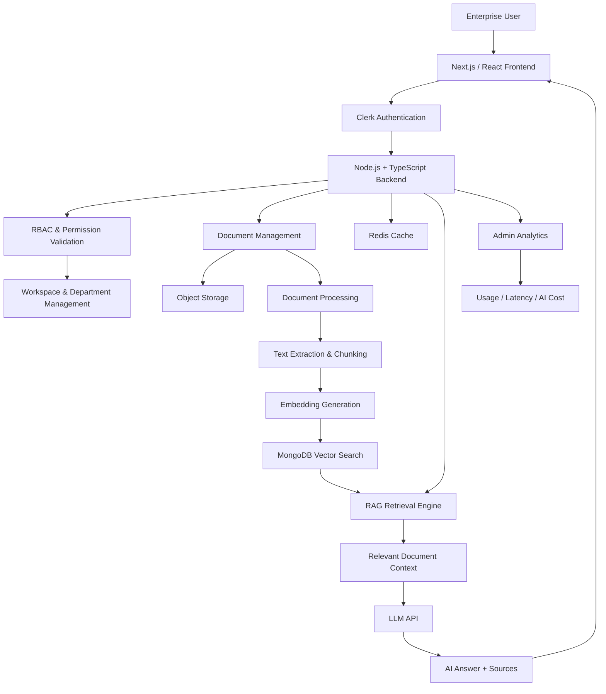
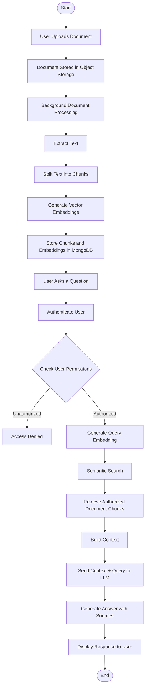

# NexusIQ — Enterprise AI Knowledge Platform 🧠

<p align="center">
  <strong>Intelligent Enterprise Knowledge Management Powered by AI & RAG</strong>
</p>

<p align="center">
  Transform enterprise documents into actionable knowledge with AI-powered search, contextual conversations, and secure document intelligence.
</p>

<p align="center">
  <a href="https://nexusiq-enterprise-ai-knowledge-platform-890005435551.asia-east1.run.app">🌐 Live Demo</a>
</p>

---

## 🚀 Overview

**NexusIQ** is an AI-powered Enterprise Knowledge Platform designed to help organizations manage, search, and interact with internal knowledge using Large Language Models (LLMs) and Retrieval-Augmented Generation (RAG).

Traditional enterprise systems store valuable information across multiple documents, PDFs, and knowledge repositories, making it difficult for employees to find accurate information quickly.

NexusIQ solves this problem by transforming enterprise documents into an intelligent, searchable knowledge base.

Users can upload documents, ask natural-language questions, and receive contextual AI-generated answers backed by relevant document references.

The platform focuses on enterprise-grade security through Role-Based Access Control (RBAC), ensuring users can only retrieve information they are authorized to access.

---

## ✨ Key Features

### 📄 1. Intelligent Document Management
- Upload and manage enterprise documents.
- Document-based knowledge ingestion.
- Process documents for AI-powered retrieval.
- Organize knowledge across workspaces.

### 🤖 2. AI-Powered Question Answering
- Ask questions in natural language.
- Get context-aware answers using RAG.
- Retrieve relevant information from uploaded documents.
- Generate answers grounded in retrieved context.

### 🔎 3. Retrieval-Augmented Generation (RAG)
- Document processing and text extraction.
- Text chunking for efficient retrieval.
- Generate vector embeddings.
- Retrieve semantically relevant document chunks.
- Provide contextual information to the LLM before generating answers.

### 🔐 4. Enterprise Security & Access Control
- Secure user authentication with Clerk.
- Role-Based Access Control (RBAC).
- Department-level document access.
- Workspace-based knowledge organization.
- Permission validation before document retrieval.

**Security principle:** Unauthorized document content must never be passed to the AI generation layer.

### 💬 5. Workspace & Chat Management
- Manage conversations across workspaces.
- Maintain chat history.
- Organize enterprise knowledge by department.
- Collect user feedback on AI-generated responses.

### 📊 6. Admin Analytics Dashboard
- Monitor platform usage.
- Track AI request activity.
- Monitor response latency.
- Track AI token consumption and estimated API costs.
- Analyze platform performance.

### ⚡ 7. Performance Optimization
- Redis-based caching.
- Efficient document retrieval.
- Optimized backend processing.
- Background document indexing.

---

## 🛠️ Tech Stack

| Technology | Purpose |
|---|---|
| Next.js / React | Frontend Development |
| Node.js | Backend Runtime |
| TypeScript | Type-safe Development |
| MongoDB | Database |
| Redis (Upstash) | Caching and Performance |
| Clerk | Authentication |
| RAG | Context-aware AI Responses |
| LLM API | AI Answer Generation |
| Vector Embeddings | Semantic Document Retrieval |
| Object Storage | Document Storage |
| Google Cloud Run | Application Deployment |

---

## 🏗️ System Architecture

NexusIQ follows a modular architecture separating the frontend, backend, authentication, document processing, retrieval, and AI generation layers.



---

## 🔄 How NexusIQ Works — RAG Workflow

The platform uses Retrieval-Augmented Generation to generate answers based on enterprise knowledge.



### RAG Pipeline Explained

1. **Document Upload:** Users upload enterprise documents.
2. **Text Extraction:** Backend extracts readable content.
3. **Chunking:** Documents are divided into smaller text segments.
4. **Embedding Generation:** Text segments are converted into vector representations.
5. **Vector Storage:** Embeddings and metadata are stored in MongoDB.
6. **User Query:** Users ask questions using natural language.
7. **Permission Validation:** System verifies user access rights.
8. **Semantic Retrieval:** Relevant authorized document chunks are retrieved.
9. **LLM Generation:** Retrieved context is provided to the LLM.
10. **Response Generation:** Platform returns contextual answers with relevant source references.

---

## 🔒 Security Architecture

Security is a critical part of an enterprise knowledge platform.

NexusIQ follows a permission-aware retrieval approach:

- Authentication using Clerk.
- Role-based authorization.
- Workspace-level access restrictions.
- Department-based document permissions.
- Server-side permission validation.
- Restricted retrieval of unauthorized knowledge.

**Important:** Access control must be enforced before retrieving document content for AI processing, rather than relying on the LLM to decide whether a user should see information.

---

## 📸 Project Screenshots

### 1. Dashboard

Overview of the enterprise knowledge platform.


### 2. AI Chat Interface

Ask questions and interact with enterprise knowledge using AI.


### 3. Document Management

Upload and organize enterprise documents.


### 4. Admin Analytics

Monitor platform usage, AI performance, and operational metrics.


> Add your actual application screenshots to the `docs/images/` folder using the filenames mentioned above.

---

## ⚙️ Installation & Setup

Follow these steps to run NexusIQ locally.

### Prerequisites

- Node.js
- npm
- MongoDB
- Redis / Upstash Redis
- Clerk Account
- LLM API Credentials

### 1. Clone the Repository

```bash
git clone YOUR_GITHUB_REPOSITORY_URL
cd NexusIQ
```

### 2. Install Dependencies

```bash
npm install
```

If your project uses separate frontend and backend directories, install dependencies in both directories.

### 3. Configure Environment Variables

Create a `.env` file and configure the required environment variables.

```env
NODE_ENV=development

# MongoDB
MONGODB_URI=your_mongodb_connection_string

# Redis
REDIS_URL=your_upstash_redis_url

# Clerk Authentication
NEXT_PUBLIC_CLERK_PUBLISHABLE_KEY=your_publishable_key
CLERK_SECRET_KEY=your_secret_key

# AI Configuration
LLM_API_KEY=your_llm_api_key

# Object Storage
STORAGE_BUCKET=your_storage_bucket
```

Use the actual environment variable names expected by your application. Never commit secret keys or production credentials to GitHub.

### 4. Start the Application

```bash
npm run dev
```

Open the application:

```text
http://localhost:3000
```

---

## ☁️ Live Deployment

The application is deployed using Google Cloud Run.

🌐 **Live Application:**

https://nexusiq-enterprise-ai-knowledge-platform-890005435551.asia-east1.run.app

---

## 💡 Why NexusIQ?

NexusIQ demonstrates practical implementation of modern full-stack and AI engineering concepts.

The project brings together:

- Full-stack application development.
- Enterprise authentication and authorization.
- Retrieval-Augmented Generation (RAG).
- Semantic search and vector embeddings.
- MongoDB-based data management.
- Redis caching.
- Background document processing.
- Secure multi-user knowledge management.
- AI usage and performance monitoring.

It demonstrates how AI can be integrated into real-world enterprise workflows while maintaining security, scalability, and contextual accuracy.

---

## 🔮 Future Enhancements

- Support for additional document formats.
- Advanced hybrid search (keyword + semantic search).
- Improved document version management.
- Streaming AI responses.
- Detailed audit logs.
- Advanced enterprise analytics.
- Multi-LLM provider support.
- Automated document re-indexing.

---

## 👨‍💻 Developer

**Ujjwal Awasthi**

B.Tech – Electronics & Communication Engineering

Interested in Software Development, Backend Engineering, Full-Stack Development, and AI-powered Applications.

📧 **Email:** ujjwalawasthi7597@gmail.com

---

<p align="center">
  <strong>Built with ❤️ by Ujjwal Awasthi</strong>
</p>

<p align="center">
  <i>Turning Enterprise Knowledge into Intelligent Insights.</i>
</p>
